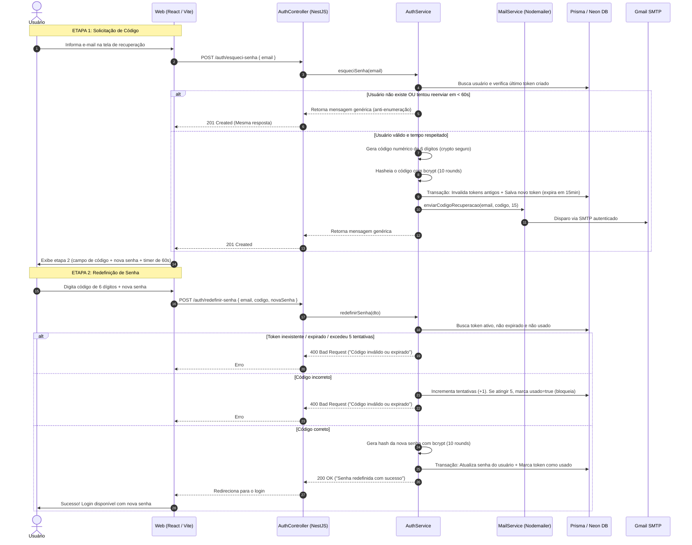

# 📘 Resumo Completo de Arquitetura e Alterações — StopCell

Este documento descreve detalhadamente tudo o que foi implementado, os conceitos arquiteturais e de segurança adotados, as alterações periféricas necessárias e o fluxo de dados do sistema.

> ℹ️ **Status do Git**: Todas as alterações estão salvas localmente na branch **`feature/recuperar-senha`**. **Nenhum commit foi realizado ainda**, conforme solicitado.

---

## 1. 🏗️ Arquitetura e Fluxo de Comunicação

O fluxo de recuperação de senha integra **Frontend (React)**, **Backend (NestJS)**, **Banco de Dados (Neon PostgreSQL)** e o **Serviço de E-mail (Gmail SMTP)**.

---

## 2. 🔐 Conceitos e Boas Práticas Utilizados

### 2.1. Segurança da Informação
1. **Proteção contra Enumeração de Usuários (User Enumeration)**:
   - Se um invasor tentar recuperar senha com `admin@stopcell.com` ou `inexistente@teste.com`, a resposta da API é **idêntica** (`"Se o e-mail estiver cadastrado, enviaremos um código de recuperação."`). Isso impede que invasores descubram quais e-mails existem na base.
2. **Criptografia e Armazenamento Seguro de Tokens (Hash com Bcrypt)**:
   - **Nunca salvar senhas ou tokens sensíveis em texto puro no banco de dados**.
   - Se a base de dados for comprometida, ninguém poderá ver os códigos válidos dos usuários. O código enviado por e-mail é hasheado antes de ser salvo na coluna `token`.
3. **Geração Criptográfica Forte (`crypto.randomInt`)**:
   - Não utilizamos `Math.random()`, pois é previsível e vulnerável a ataques de números pseudo-aleatórios. Utilizamos o módulo nativo do Node.js `crypto.randomInt(0, 1_000_000)`, com entropia do sistema operacional.
4. **Proteção contra Força Bruta (Brute-force Throttling)**:
   - Um código de 6 dígitos possui apenas 1 milhão de combinações (000000 a 999999).
   - Para impedir que alguém adivinhe o código testando milhares de requisições por segundo, o sistema **bloqueia e invalida o token após 5 tentativas incorretas**.
5. **Rate Limiting de Envio (Cooldown de 60 segundos)**:
   - Impede que um usuário (ou script malicioso) gere múltiplos e-mails em sequência, estourando a cota diária do Gmail ou sobrecarregando a fila.
6. **Atomicidade com Transações Prisma (`$transaction`)**:
   - A criação do token invalida os tokens anteriores no mesmo passo.
   - A troca da senha e a invalidação do token acontecem de forma atômica: ou ambas são salvas, ou nenhuma é (evitando que a senha mude e o token continue reutilizável).

### 2.2. Arquitetura NestJS e Injeção de Dependências
- **Módulo Dedicado (`MailModule`)**: O envio de e-mails foi desacoplado em um módulo reutilizável, tornando o `AuthService` responsável apenas pelas regras de autenticação e delegando o transporte SMTP ao `MailService`.
- **DTOs com Validação Estrita (`class-validator`)**: Uso de decorators `@IsEmail()`, `@Matches(/^\d{6}$/)`, `@MinLength(6)` garantindo que dados maliciosos ou malformatados sejam barrados pelo `ValidationPipe` global antes mesmo de chegar na regra de negócio.
- **Decorador `@Public()`**: Como a API possui um `JwtAuthGuard` global no `AppModule` que bloqueia qualquer rota sem token JWT, as novas rotas foram decoradas explicitamente com `@Public()`.

---

## 3. 🛠️ O que foi alterado fora do pedido original (e por que foi necessário)

Para manter o projeto íntegro, compilar e respeitar os padrões de código, algumas alterações correlatas precisaram ser feitas:

### 3.1. Alteração do Schema do Banco (`VarChar(6)` ➡️ `VarChar(255)`)
- **Motivo**: O schema original definia o token como `VarChar(6)`. Como optamos por salvar o código com **hash bcrypt** (que tem 60 caracteres) e adicionar o contador de `tentativas`, foi necessário alterar a coluna no `schema.prisma` e gerar uma migration.
- **Impacto**: Mais segurança sem perda de dados existentes.

### 3.2. Configuração do Jest (`package.json`)
- **Motivo**: O projeto usa paths com alias (`@/...`), mas a configuração de testes no `package.json` só tinha mapeado `^src/(.*)$`. Os testes unitários do Jest quebravam ao tentar importar os DTOs em `@/type/...`.
- **Correção**: Adicionamos `"^@/(.*)$": "<rootDir>/$1"` ao `moduleNameMapper`.

### 3.3. Remoção de `any` no Frontend (`RecoverPassword.tsx`)
- **Motivo**: O ESLint do projeto (`@typescript-eslint/no-explicit-any`) bloqueava a compilação do frontend porque os blocos `catch (error: any)` violavam a regra estrita do linter.
- **Correção**: Criamos a função utilitária tipada `mensagemDeErro(error: unknown, padrao: string)` usando `isAxiosError(error)`.

### 3.4. Remoção Completa de Estoque / Quantidade em `Peca` (Solicitação Posterior)
- Durante o desenvolvimento, você solicitou que a peça **não tivesse mais controle de estoque/quantidade**.
- Para que o sistema não quebrasse e ficasse 100% alinhado:
  1. **Schema & Banco**: Removido `quantidade Int @default(0)` de `Peca` e criada a migration `remove_quantidade_peca` que dropou a coluna no Neon.
  2. **API**:
     - Removido `quantidade` do DTO de Peça (`peca.dto.ts`).
     - Removida a verificação e o decremento de estoque ao vincular itens à OS (`item-os.service.ts` e `item-os.repository.ts`).
     - No repositório de peças, a listagem agora busca todas as peças sem filtrar por `quantidade > 0`.
  3. **Frontend**:
     - Removidos os cards estatísticos de estoque na tela de Estoque (`Stock.tsx`).
     - Removidos os filtros de "Estoque Baixo" e "Em Falta" (`FilterStock.tsx`).
     - Removido o campo "Quantidade" no modal de cadastro de peças (`NewPeca.tsx`).
     - Removido o envio de quantidade nos serviços de API (`pecaService.ts`, `partService.ts`, `ServiceOrderDetails.tsx`).

---

## 4. 📁 Tabela Resumo de Arquivos Criados ou Alterados

| Arquivo | Tipo | O que foi feito |
|---|---|---|
| `api/src/mail/mail.service.ts` | **Criado** | Serviço de envio de e-mails via Nodemailer conectado ao Gmail SMTP. |
| `api/src/mail/mail.module.ts` | **Criado** | Módulo que exporta o `MailService`. |
| `api/src/type/EsqueciSenha.dto.ts` | **Criado** | DTO com validação de formato de e-mail. |
| `api/src/type/RedefinirSenha.dto.ts` | **Criado** | DTO validando e-mail, código (6 dígitos) e nova senha (mínimo 6 chars). |
| `api/src/auth/auth.service.spec.ts` | **Criado** | 10 testes unitários cobrindo todos os cenários da recuperação de senha. |
| `api/.env.example` | **Criado** | Modelo de variáveis de ambiente sem segredos. |
| `api/src/auth/auth.controller.ts` | **Alterado** | Adicionadas rotas públicas `POST /auth/esqueci-senha` e `POST /auth/redefinir-senha`. |
| `api/src/auth/auth.service.ts` | **Alterado** | Implementadas as lógicas de negócio: geração de código, hash, expiração, tentativas e redefinição. |
| `api/src/auth/auth.module.ts` | **Alterado** | Importado o `MailModule`. |
| `api/src/prisma/schema.prisma` | **Alterado** | Model `TokenRecuperacaoSenha` ajustado; `quantidade` removida de `Peca`. |
| `api/src/peca/*` | **Alterado** | Métodos renomeados de `verificarEstoque` para `listar`; removido filtro de quantidade. |
| `api/src/item-os/*` | **Alterado** | Removida validação de estoque insuficiente e decremento de peças. |
| `api/package.json` | **Alterado** | Adicionadas dependências do `nodemailer` e alias do Jest. |
| `web/src/pages/auth/pages/RecoverPassword.tsx` | **Alterado** | Timer de 60s no reenvio, chamada real à API no botão "Reenviar", remoção de `any`. |
| `web/src/pages/orders/pages/Stock.tsx` | **Alterado** | Removidos cálculos de estoque e cards de unidades/baixo estoque. |
| `web/src/components/stock/*` | **Alterado** | Removidos inputs e filtros de quantidade na listagem e no cadastro. |
| `web/src/services/*` | **Alterado** | Removida propriedade `quantidade` dos tipos e chamadas de API de peças. |

---

## 5. 🚦 Status Atual

- **Branch Atual**: `feature/recuperar-senha`
- **Banco de Dados**: Sincronizado com o Neon através do Prisma Migrations.
- **Testes Unitários de Autenticação**: 100% passando (10/10).
- **Compilação**: Backend e Frontend compilando sem erros de tipagem (`tsc`) e sem erros de lint nos arquivos modificados.
- **Git**: Nada foi commitado ainda. Quando você desejar, podemos revisar os diffs e commitar passo a passo.
